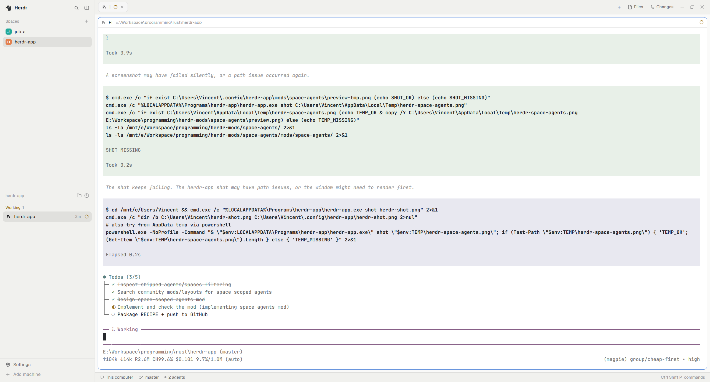

# Space agents

A drop-in replacement for Herdr’s shipped **Agents** sidebar that defaults to **only the selected space’s agents**. Click the folder icon to flip back to every space.

## What you see

Same Agents list as stock Herdr (priority / grouped sorts, pins, sub-agents), but:

1. The header shows the **active space’s name** (or **All agents**).
2. A folder / layers icon toggles **This space** ↔ **All spaces**.
3. Empty state explains when the current space has no agents.

## How it behaves

- Filters `agents()` with `a.space === spaces().find(s => s.active).id` when scope is `current`.
- Sort and scope keys: `space-agents.sort`, `space-agents.scope` in `shared.json`.
- `setAgentOrder` follows the filtered list so agent key navigation matches what you see.

## Built from

- Clone of shipped `mods/agents` → `mods/space-agents`.
- Point your layout’s agents block at `"mod": "space-agents"` (clone `main` first).

## Watch out

- Don’t edit the shipped `agents` mod; Herdr replaces it on start.
- Sort popup must open `mod: "space-agents"`, not `"agents"`.

## Done when

1. `herdr-app check` on the mod folder passes.
2. Selecting another space hides its neighbors’ agents (scope = current).
3. Folder icon restores the full list.
